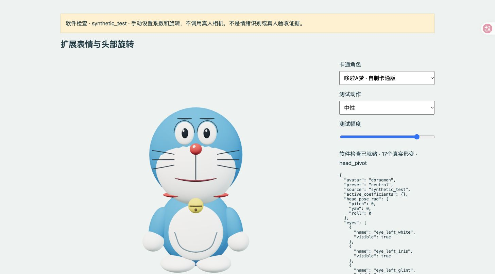
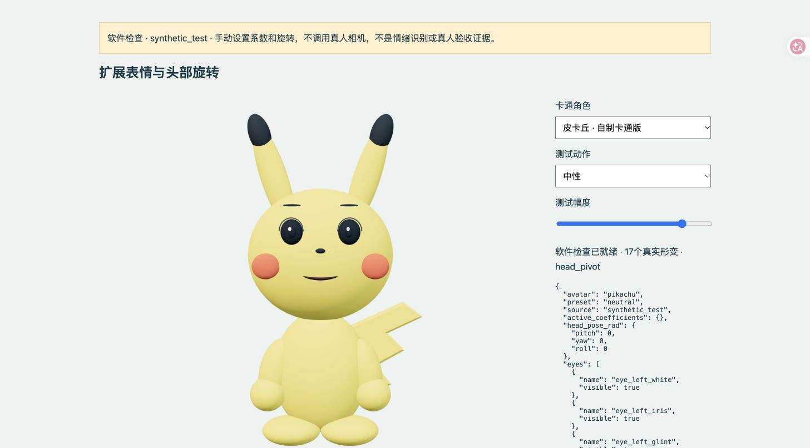
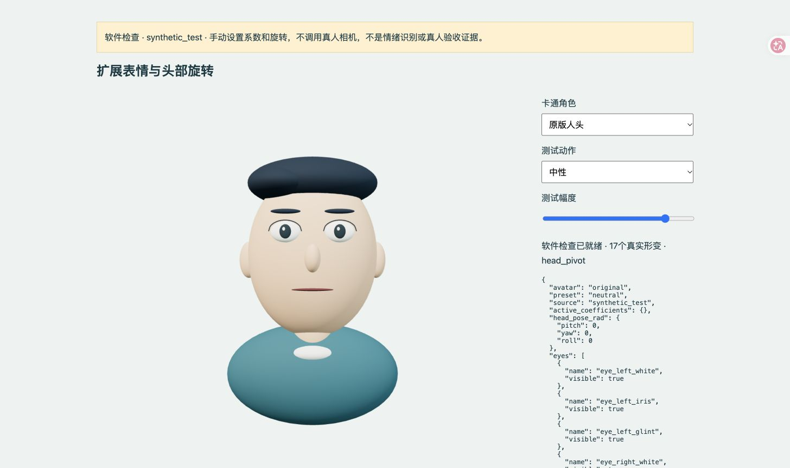

# 3DExpression：实时面部表情与头部跟随

本地 MediaPipe Web + Three.js 原型。软件 **0.5.0**，三条件协议 **IPP31078-ABC60-v5**，工程评估协议 **IPP31078-EVAL-v1**。

可驱动17个真实形变系数：张嘴、左右眨眼、微笑、嘴角下压/眉心上抬（伤心动作）、抬眉睁眼（惊讶动作）、皱眉抿嘴、噘嘴。头部支持左右转动、上下点头和侧倾，中性校准后取相对旋转并限制幅度。动作名称不表示对本人真实情绪的判断。提供**原版人头**、**哆啦A梦**和**皮卡丘**三种自制化身，页面上可切换。B不使用自动动画；A使用独立真实跟踪录制的动态表情参数。闭眼由上下眼皮覆盖固定眼球、合拢闭眼线实现；眨眼通道使用独立35ms平滑，较小的真实闭眼幅度也能驱动完整闭合。

[统一实验设置与报告基准](materials/实验设置与报告引用基准_v5.md) · [持续开发交接](DEVELOPMENT.md)

## v5三条件实验

研究主题：化身面部表情的反馈来源与时间同步性对用户交互体验的影响。A=`A_prerecorded`独立真实跟踪录制动态表情，B=`B_realtime`本人实时驱动，C=`C_delayed`在B相同处理后增加默认400ms时间戳缓冲。C不阻塞推理、不延迟头部。静态按钮仅调试。

每条件60秒：适应10秒、基础动作20秒、自由表达20秒、整体观察10秒。支持ABC/ACB/BAC/BCA/CAB/CBA六种顺序，每条件立即填写相同六题，最后选整体偏好或无明显偏好；只收匿名编号。

先由非参与者在实时预览中录制75–120秒真实参数，最低连续60秒；自然混合眨眼、微笑、张嘴和抬眉，非固定节拍、不按正式任务提示编排。A加载录制后已完成相同映射平滑的系数，不是手工关键帧，不循环或重复平滑。正式前人工回放并用独立内部试采匹配活动量，冻结素材SHA；缺少真实素材时不能开始。

新问卷表`data/raw/participants_v5.csv`，历史表、旧静态A与v4原始数据不改或混合。输入与输出时间、设定及实际缓冲延迟分别保存，A响应延迟为空。400ms不代表屏幕端到端视觉延迟。可导出完整JSON、帧CSV、问卷CSV、偏好CSV；统计默认`data/processed/abc_v5`。先保存旧会话再重启服务，确认0.5.0 / ABC60-v5。

详细[协议](materials/experience_protocol.md)、[操作说明](materials/operator_guide.md)、[数据字典](materials/data_dictionary.md)、[六题问卷](materials/questionnaire_blank.md)。A/B有内容混淆，B/C延迟控制更明确；不是完整双因素析因设计，不预写主效应、交互或效果结论。论文正文暂不修改。

## 快速启动

需要桌面 Chrome、摄像头和 Python 3.12+。仓库包含自制GLB与固定依赖清单；首次从源码克隆时下载运行依赖，此后可离线使用。普通体验不需要Node.js。

```sh
python3 scripts/fetch_assets.py
python3 launch.py serve
```

Windows 可用 `py -3` 替换 `python3`。在本机Chrome打开 **http://127.0.0.1:8765/?mode=demo&ui=031**，保持服务窗口打开。已有完整本地资产时，可双击“启动_笔记本.command”或Windows启动脚本。不要直接双击HTML。

先选择角色；切换后需要重新校准，整个三条件体验锁定同一角色。本人勾选知情说明并开启摄像头；正对镜头、合嘴睁眼、放松面部及头部，完成3秒中性校准。在 **B · 实时跟随** 检查表情和转头；静态中性按钮只作调试；正式A是预录动态表情，B为本人实时驱动，头部跟随在三条件相同，C只延迟面部。追踪丢失回中性，恢复后继续。

代码只请求本机相机，不请求麦克风。视频与参数在本机处理；只有主动录制、保存才写入项目。上传仓库不包含真人画面、录像、参与者记录或学校个人材料。

## 工程评估

展开预览页的“工程评估：性能与交互行为”，先保持中性10秒，再逐项检查动作。实际成功次数由操作者填写；未核对保持空值。结束后保存记录并运行：

```sh
python3 launch.py evaluate
```

输出 `data/processed/evaluation/report.md`、`metrics.csv`、`results.json`、`validation_issues.csv`。覆盖7项系统性能和5项交互行为指标，定义见 [评估协议](materials/evaluation_protocol.md)。缺少必要数据时显示待采集，不填零。

- 跟踪与渲染速率来自实际结果时间戳和渲染调用计数；丢帧使用浏览器视频计数。
- 中性参数抖动、逐动作驱动一致性及切换信号描述需要已标记的任务段。
- 响应成功率使用真实人工观察次数，不能用参数阈值周期数代替。
- **物理端到端延迟、表情响应时间和准确恢复时间需要同步录像标注。** 内置浏览器合成录像、单次推理耗时、视频到渲染提交的管线时间不能冒充物理端到端延迟。空白视频标注表在 `materials/video_metric_annotations.csv`。

## 录像与三条件体验

完成校准后点击“开始真人演示录像”，连续录22–25秒，在停止后保存。输出真人小窗、化身和参数组合画面至 `media/raw/01_live.mp4` 及来源侧录；同名文件不覆盖。浏览器只提供WebM时需本机FFmpeg转换，不能只改扩展名。

正式体验入口为 http://127.0.0.1:8765/ 或上方“三条件体验”。每条件60秒，支持六种ABC排列顺序，六题1–7分自编问卷逐题报告，不合成为具身感总分。正式任务与自评期间隐藏本人小窗。完整JSON、参数CSV、问卷CSV和偏好CSV可保存和导出。

v3.1增加角色选择和闭眼重定向；问卷与v3.0、v2按协议分开。正式采集建议统一使用一个角色，完整JSON记录角色与模型摘要。**不能把不同版本、不同角色的差异直接归因为表情驱动效果**。旧工程JSON可以由评估脚本按版本分别读取；原始文件保持不变。当前代码和软件检查不构成人群效果、真人动作准确率或研究假设已成立的证明。

## 开发与验证

重建自制GLB需要Node.js；运行和工程分析不需要npm安装。

```sh
node scripts/create_avatar.mjs
node scripts/build.mjs
node --test tests/core.test.mjs tests/expressions.test.mjs tests/prerecorded.test.mjs tests/delay.test.mjs tests/tracker.test.mjs tests/ui-flow.test.mjs
python3 -m unittest discover -s tests -p 'test_*.py' -v
```

软件形变与模型检查页：http://127.0.0.1:8765/software-check.html 。页面明确标识 `synthetic_test`，只手动设置测试系数，不打开真人相机。示例：





闭眼检查：[哆啦A梦](docs/assets/SYNTHETIC_doraemon_closed.jpg)、[皮卡丘](docs/assets/SYNTHETIC_pikachu_closed.jpg)。这些是手动系数检查画面，软件预设不替代真人跟随验收。

原版人头保留原有18个部件的中性几何，加入新版上下眼皮与闭眼线。软件预览：



本轮范围只含卡通化身，不包含真人重建或3DGS。

原型固定使用Three.js 0.160.1、MediaPipe Tasks Vision 0.10.21和官方float16/1面部模型。依赖来源与SHA-256在 `evidence/dependency_lock.json`，许可及实际映射见 [ASSET_SOURCES.md](ASSET_SOURCES.md)。自制代码和模型未额外指定开源授权条款；第三方依赖继续适用各自许可。
