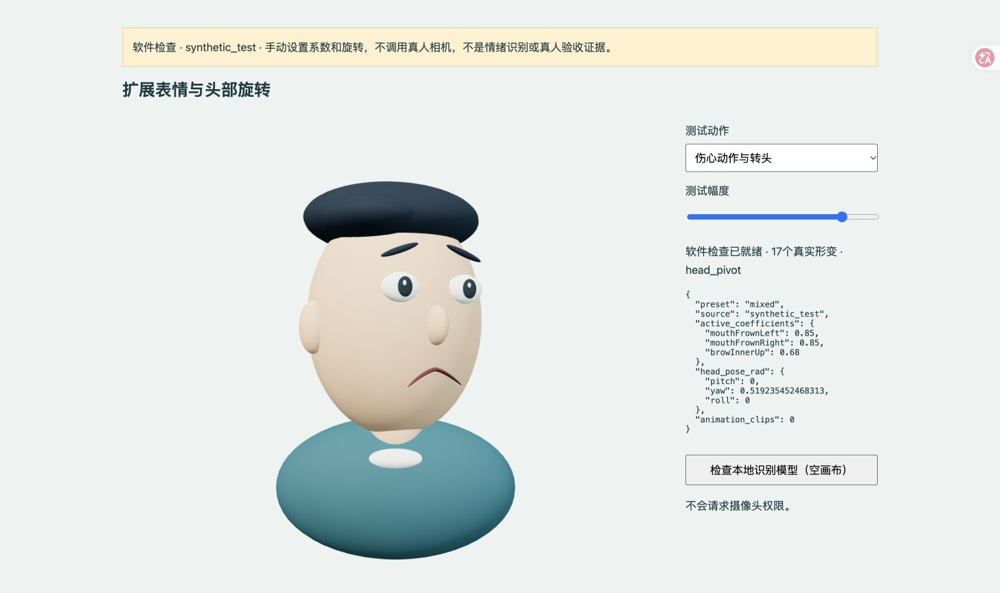

# 3DExpression：实时面部表情与头部跟随

本地 MediaPipe Web + Three.js 原型。软件 **0.3.0**，A/B 协议 **IPP31078-AB90-v3**，工程评估协议 **IPP31078-EVAL-v1**。

可驱动17个真实形变系数：张嘴、左右眨眼、微笑、嘴角下压/眉心上抬（伤心动作）、抬眉睁眼（惊讶动作）、皱眉抿嘴、噘嘴。头部支持左右转动、上下点头和侧倾，中性校准后取相对旋转并限制幅度。动作名称不表示对本人真实情绪的判断。化身为项目自制几何模型，没有自动眨眼或预录表情。

## 快速启动

需要桌面 Chrome、摄像头和 Python 3.12+。仓库包含自制GLB与固定依赖清单；首次从源码克隆时下载运行依赖，此后可离线使用。普通体验不需要Node.js。

```sh
python3 scripts/fetch_assets.py
python3 launch.py serve
```

Windows 可用 `py -3` 替换 `python3`。在本机Chrome打开 **http://127.0.0.1:8765/?mode=demo&ui=030**，保持服务窗口打开。已有完整本地资产时，可双击“启动_笔记本.command”或Windows启动脚本。不要直接双击HTML。

本人勾选知情说明并开启摄像头；正对镜头、合嘴睁眼、放松面部及头部，完成3秒中性校准。在 **B · 实时跟随** 检查表情和转头；**A · 静态**只保持表情中性，头部跟随在两条件相同。追踪丢失回中性，恢复后继续。

代码只请求本机相机，不请求麦克风。视频与参数在本机处理；只有主动录制、保存才写入项目。上传仓库不包含真人画面、录像、参与者记录或学校个人材料。

## 工程评估

展开预览页的“工程评估：性能与交互行为”，先保持中性10秒，再逐项检查动作。实际成功次数由操作者填写；未核对保持空值。结束后保存记录并运行：

```sh
python3 launch.py evaluate
```

输出 `data/processed/evaluation/report.md`、`metrics.csv`、`results.json`、`validation_issues.csv`。覆盖7项系统性能和5项交互行为指标，定义见 [评估协议](materials/evaluation_protocol.md)。缺少必要数据时显示待采集，不填零。

- 跟踪与渲染速率来自实际结果时间戳和渲染调用计数；丢帧使用浏览器视频计数。
- 中性参数抖动、逐动作驱动一致性及切换信号描述需要已标记的任务段。
- 响应成功率使用真实人工观察次数，不能用参数阈值周期数代替。
- **物理端到端延迟、表情响应时间和准确恢复时间需要同步录像标注。** 内置浏览器合成录像、单次推理耗时、视频到渲染提交的管线时间不能冒充物理端到端延迟。空白视频标注表在 `materials/video_metric_annotations.csv`。

## 录像与A/B体验

完成校准后点击“开始真人演示录像”，连续录22–25秒，在停止后保存。输出真人小窗、化身和参数组合画面至 `media/raw/01_live.mp4` 及来源侧录；同名文件不覆盖。浏览器只提供WebM时需本机FFmpeg转换，不能只改扩展名。

正式体验入口为 http://127.0.0.1:8765/ 或上方“A/B体验”。每条件90秒，采用AB/BA顺序，四题1–7分自编问卷逐题报告，不合成为具身感总分。正式任务与自评期间隐藏本人小窗。完整JSON、参数CSV和问卷CSV可保存和导出。

v3加入17个系数和共用头部跟随，**不能与v2五系数、固定头位的问卷混合分析**。旧工程JSON可以由评估脚本按版本分别读取；原始文件保持不变。当前代码和软件检查不构成人群效果、真人动作准确率或研究假设已成立的证明。

## 开发与验证

重建自制GLB需要Node.js；运行和工程分析不需要npm安装。

```sh
node scripts/create_avatar.mjs
node scripts/build.mjs
node --test tests/core.test.mjs tests/expressions.test.mjs
python3 -m unittest discover -s tests -p 'test_*.py' -v
```

软件形变与模型检查页：http://127.0.0.1:8765/software-check.html 。页面明确标识 `synthetic_test`，只手动设置测试系数，不打开真人相机。示例：



原型固定使用Three.js 0.160.1、MediaPipe Tasks Vision 0.10.21和官方float16/1面部模型。依赖来源与SHA-256在 `evidence/dependency_lock.json`，许可及实际映射见 [ASSET_SOURCES.md](ASSET_SOURCES.md)。自制代码和模型未额外指定开源授权条款；第三方依赖继续适用各自许可。
